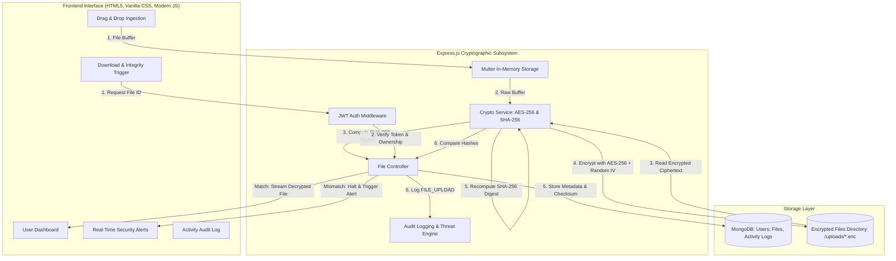

# 🛡️ Secure Digital Vault &mdash; Web Application

> **A Confidential, Authenticated, and Tamper-Proof Digital Repository**  
> Built with **Node.js, Express.js, MongoDB, AES-256 Cryptography, and SHA-256 Integrity Verification**.

---

## 📌 Project Overview

The **Secure Digital Vault** is a secure web application developed for storing, managing, and retrieving sensitive digital files. It provides end-to-end security by combining:
1. **Confidentiality**: All uploaded files are encrypted using **AES-256-CBC** before being written to persistent storage.
2. **Integrity**: Prior to encryption, a **SHA-256 cryptographic digest** is computed. Upon download, the decrypted payload is recalculated and strictly verified against the stored hash. If any bit-level tampering or corruption occurs, the download is immediately halted.
3. **Authentication & Authorization**: Stateless **JWT (JSON Web Tokens)** coupled with **bcrypt** salted password hashing and strict ownership verification (preventing Insecure Direct Object References - IDOR).
4. **Account Defense**: Rate limiting on authentication endpoints and automatic account lockout after consecutive failed login attempts to mitigate brute-force attacks.
5. **Activity Monitoring & Alerts**: Comprehensive audit trail recording all user events and real-time security alerts for tampering and unauthorized access.

---

## 🏛️ System Architecture



---

## 🚀 Key Features

* **Zero-Plaintext Storage**: Files on disk are stored exclusively as AES-256 ciphertext (`.enc`).
* **Cryptographic Integrity Gate**: SHA-256 hash comparison guarantees that no corrupted or tampered file is ever delivered to the user.
* **Interactive Tamper Simulator (Demo / Viva Feature)**: Allows demonstrators to simulate storage-level tampering with a single click to visually prove how the SHA-256 integrity gate detects and blocks modified files.
* **Brute-Force Defense & Account Lockout**: Limits failed login attempts and applies temporary account lockout.
* **Strict Multi-Tenant Isolation**: Users cannot access, modify, or delete other users' files by modifying URL IDs.
* **Comprehensive Audit Trail**: Timestamped logs with client IP addresses, action types, and status indicators (`SUCCESS`, `WARNING`, `ALERT`, `FAILURE`).
* **Dual Database Mode**: Seamlessly connects to MongoDB Atlas or local MongoDB; automatically provides an embedded in-memory database fallback for zero-config demonstration.

---

## 🛠️ Technology Stack

| Layer | Technology |
| :--- | :--- |
| **Frontend** | HTML5, Vanilla CSS3 (Custom Dark Cyber Slate Design System), JavaScript (ES6+) |
| **Backend** | Node.js, Express.js |
| **Database** | MongoDB (via Mongoose ODM) |
| **Authentication** | JSON Web Tokens (`jsonwebtoken`), `bcryptjs` (Salt Rounds: 10) |
| **File Handling** | Multer (In-Memory Processing) |
| **Symmetric Encryption** | AES-256-CBC (`crypto.createCipheriv` with 16-byte random IV per file) |
| **Hash Verification** | SHA-256 (`crypto.createHash('sha256')`) |
| **Security Headers** | Helmet.js, CORS, Express-Rate-Limit |

---

## 📂 Project Structure

```text
Secure Digital Vault/
├── server/
│   ├── config/
│   │   ├── db.js             # MongoDB connection manager & fallback
│   │   └── env.js            # Environment loader & AES key validator
│   ├── controllers/
│   │   ├── authController.js # Registration, login, lockout, JWT
│   │   ├── fileController.js # AES-256 upload, decrypt, SHA-256 verify, delete
│   │   └── logController.js  # Activity logs, security alerts, vault stats
│   ├── middleware/
│   │   ├── authMiddleware.js # JWT validation & IDOR ownership checks
│   │   ├── uploadMiddleware.js # Multer in-memory upload handler
│   │   ├── securityMiddleware.js # Rate limiters & Helmet headers
│   │   └── errorHandler.js   # Centralized safe error handler
│   ├── models/
│   │   ├── User.js           # User schema with bcrypt pre-save hook
│   │   ├── File.js           # File metadata, SHA-256 hash, IV schema
│   │   └── ActivityLog.js    # Audit log & threat alert schema
│   ├── routes/
│   │   ├── authRoutes.js     # /api/auth routes
│   │   ├── fileRoutes.js     # /api/files routes
│   │   └── logRoutes.js      # /api/logs routes
│   ├── services/
│   │   ├── cryptoService.js  # AES-256-CBC cipher and SHA-256 digest engine
│   │   └── logService.js     # Logging and threat alert helper service
│   ├── uploads/              # Encrypted ciphertext storage directory
│   └── server.js             # Express application entry point
├── frontend/
│   ├── index.html            # Landing page & Cryptographic overview
│   ├── login.html            # User login with demo auto-fill
│   ├── register.html         # User registration with password strength meter
│   ├── dashboard.html        # Secure digital vault dashboard & inspector
│   ├── css/
│   │   └── style.css         # Complete design system & styles
│   └── js/
│       ├── api.js            # Fetch wrapper with JWT header injection
│       ├── alerts.js         # Toast notifications & modal alerts
│       ├── auth.js           # Auth forms & session management
│       └── dashboard.js      # Vault file manager & live monitoring
├── test/
│   └── test-vault.js         # Automated end-to-end test suite
├── .env.example              # Sample environment configuration
├── .env                      # Active environment configuration
├── .gitignore                # Git ignore rules
├── package.json              # Project dependencies & scripts
└── README.md                 # Project documentation
```

---

## ⚙️ Installation & Setup

### Prerequisites
* [Node.js](https://nodejs.org/) (v16.0.0 or higher)
* [MongoDB](https://www.mongodb.com/) (Optional: Local daemon or MongoDB Atlas URI; an automatic in-memory fallback is included if MongoDB is not installed locally)

### 1. Clone or Open the Repository
```bash
cd "c:/Users/ashvitha/OneDrive/6224/Secure Digital Vault"
```

### 2. Install Dependencies
```bash
npm install
```

### 3. Configure Environment Variables
Copy `.env.example` to `.env` (or use the pre-configured `.env`):
```bash
cp .env.example .env
```

**Configuration Details (`.env`):**
```env
PORT=5000
MONGODB_URI=mongodb://127.0.0.1:27017/secure_digital_vault
JWT_SECRET=super_secret_secure_digital_vault_jwt_key_2026_987654321
JWT_EXPIRES_IN=24h
AES_ENCRYPTION_KEY=e4d2a1b9f7c385419028eab716d93425081faec6291b7e43da52c80914bf8201
RATE_LIMIT_WINDOW_MS=900000
RATE_LIMIT_MAX=200
```
> **Note on AES Key**: The `AES_ENCRYPTION_KEY` must be exactly 32 bytes (64 hexadecimal characters). You can generate a new one with:  
> `node -e "console.log(require('crypto').randomBytes(32).toString('hex'))"`

---

## 🖥️ Running the Application

### Start the Server
```bash
npm start
```
* The server will initialize at: **`http://localhost:5000`**
* Open your browser and navigate to `http://localhost:5000` to access the application.

### Run Automated Tests
```bash
npm test
```
* Runs the automated test suite testing user authentication, AES-256 encryption, SHA-256 hash checks, IDOR protection, tamper detection, and security logging.

---

## 🔒 Deep Dive: How the Security Works

### 1. AES-256-CBC File Encryption Pipeline
1. When a user uploads a file, Multer loads the buffer into server RAM (not disk).
2. A random 16-byte **Initialization Vector (IV)** is generated via `crypto.randomBytes(16)`.
3. The file buffer is encrypted with the 256-bit secret key and the IV:
   $$\text{Ciphertext} = \mathbf{E}_{\text{AES-256-CBC}}(\text{Plaintext}, K, \text{IV})$$
4. The resulting ciphertext is written to `server/uploads/<uuid>.enc`. The original plaintext never exists on disk.
5. The `fileId`, `originalName`, `size`, `sha256Hash`, `iv`, and owner `userId` are stored in MongoDB.

### 2. SHA-256 Integrity Verification Pipeline
1. During upload, the SHA-256 hash of the unencrypted file is calculated:
   $$H_{\text{original}} = \text{SHA-256}(\text{Plaintext})$$
2. During download, the server reads `<uuid>.enc`, decrypts it back to memory using the stored IV:
   $$\text{Decrypted\_Buffer} = \mathbf{D}_{\text{AES-256-CBC}}(\text{Ciphertext}, K, \text{IV})$$
3. The server computes the new SHA-256 hash:
   $$H_{\text{new}} = \text{SHA-256}(\text{Decrypted\_Buffer})$$
4. **Verification Gate**:
   $$\text{if } H_{\text{new}} == H_{\text{original}} \implies \text{Allow Download}$$
   $$\text{if } H_{\text{new}} \ne H_{\text{original}} \implies \text{Block Download (409 Conflict) \& Trigger Threat Alert}$$

---

## 🎓 College Mini-Project Viva / Presentation Guide

Follow these steps to demonstrate the project to your professors or evaluators:

### Step 1: User Registration & Login
1. Click **"Create Vault"** or navigate to `register.html`.
2. Notice the **live password strength meter** checking for 8+ characters, uppercase, numbers, and symbols.
3. Register an account and sign in.

### Step 2: Confidential File Upload
1. In the Dashboard, drag and drop any file (e.g. `secret_document.pdf` or a text file).
2. Click **"Encrypt & Upload to Vault"**.
3. Point out:
   * The displayed **SHA-256 Hash** (truncated for clean UI, click to copy full 64-character hex digest).
   * The **AES-256-CBC** status badge.
   * Open the local folder `server/uploads/` to prove to evaluators that the file stored on disk is encrypted ciphertext and completely unreadable.

### Step 3: Legitimate Download & Decryption
1. Click **"⬇️ Download & Verify"**.
2. The server decrypts the ciphertext, checks the SHA-256 checksum, verifies byte-for-byte authenticity, streams the file to the browser, and shows a green **Integrity Verified** toast.

### Step 4: Live Tampering Attack Demonstration (The Star Feature! 🌟)
1. Click the **"⚡ Tamper (Demo)"** button next to your uploaded file.
2. This intentionally flips bits in the ciphertext stored on disk, simulating a hacker altering the server's storage.
3. Click **"⬇️ Download & Verify"** on the tampered file.
4. **Result**:
   * The vault blocks the download immediately.
   * A high-contrast **409 SECURITY ALERT** toast appears notifying of a cryptographic hash mismatch.
   * Switch to the **"🚨 Security Alerts"** tab to show the recorded `INTEGRITY_MISMATCH` alert.
5. Click **"🔄 Restore"** to return the file to its authentic state.

### Step 5: Access Control & IDOR Prevention
1. Open an Incognito window, register a second user (`User B`).
2. Show that `User B`'s dashboard has an empty vault and cannot see `User A`'s files.
3. Even if `User B` calls the API with `User A`'s `fileId`, the server returns **403 Forbidden** and logs an `UNAUTHORIZED_ACCESS` security event.

---

## 📡 REST API Reference

### Authentication Endpoints (`/api/auth`)
| Method | Endpoint | Description | Access |
| :--- | :--- | :--- | :--- |
| `POST` | `/api/auth/register` | Register a new user | Public |
| `POST` | `/api/auth/login` | Authenticate user & receive JWT | Public |
| `GET` | `/api/auth/me` | Get current user profile | Private (JWT) |
| `POST` | `/api/auth/logout` | End session & log activity | Private (JWT) |

### File Operations (`/api/files`)
| Method | Endpoint | Description | Access |
| :--- | :--- | :--- | :--- |
| `POST` | `/api/files/upload` | Upload, hash (SHA-256), and AES-256 encrypt file | Private (JWT) |
| `GET` | `/api/files` | Get list of user's encrypted files | Private (JWT) |
| `GET` | `/api/files/:id/download` | Decrypt, verify SHA-256 integrity, & stream file | Private (JWT) |
| `DELETE` | `/api/files/:id` | Erase ciphertext from disk & metadata from DB | Private (JWT) |
| `POST` | `/api/files/:id/simulate-tamper` | Demonstration toggle: simulate storage tampering | Private (JWT) |

### Audit Logs & Monitoring (`/api/logs`)
| Method | Endpoint | Description | Access |
| :--- | :--- | :--- | :--- |
| `GET` | `/api/logs` | Retrieve user activity audit trail | Private (JWT) |
| `GET` | `/api/logs/alerts` | Retrieve threat alerts (failed logins, integrity violations) | Private (JWT) |
| `GET` | `/api/logs/stats` | Retrieve vault metrics (file count, bytes stored, health) | Private (JWT) |

---

## 🔮 Future Enhancements

* **Multi-Factor Authentication (MFA/TOTP)**: Integration with Google Authenticator.
* **Client-Side End-to-End Encryption (Zero-Knowledge WebCrypto API)**: Encrypting in the browser before transmission.
* **Granular Time-Expiring Secure File Sharing Links**: Ephemeral pre-signed download tokens.
* **Encrypted File Shredding**: DoD 5220.22-M multi-pass overwriting for file deletions.

---

## 📜 License
MIT License &mdash; Free for academic and mini-project educational use.
